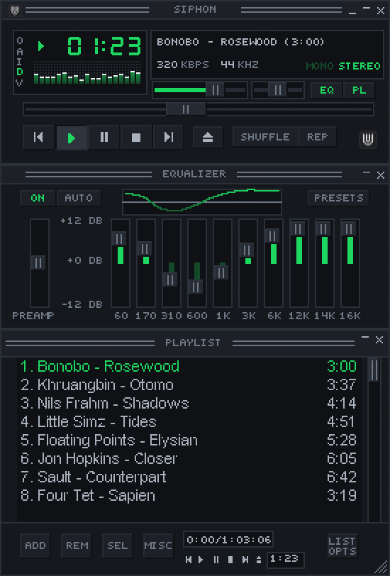

<p align="center">
  
</p>

<h1 align="center">Siphon</h1>

<p align="center"><strong>Spotify, native and fast.</strong><br>A lightweight music app for Linux, macOS, and Windows.</p>

<p align="center">
  <a href="https://spotifast.rocks/download/"><strong>Download</strong></a> ·
  <a href="https://spotifast.rocks/getting-started/">Getting started</a> ·
  <a href="https://spotifast.rocks/using-spotifast/">User guide</a> ·
  <a href="CONTRIBUTING.md">Contribute</a>
</p>

<p align="center">
  <a href="Cargo.toml"></a>
  <a href="https://spotifast.rocks/download/"></a>
  <a href="LICENSE"></a>
</p>

Siphon began as a fork of [Spotifast](https://github.com/crmne/spotifast),
created by Carmine Paolino and its contributors. The upstream MIT licence,
copyright notices and dependency attributions remain intact in [LICENSE](LICENSE).
The name and nested-U logo match the owner's Siphon browser extension;
this player keeps its existing interface styling.

On first launch, empty player folders adopt the old Spotifast settings,
state and caches, including Spotify credentials, SoundCloud account state,
mixed playlists and overlays. Existing Siphon data takes precedence. The
browser helper's `%LOCALAPPDATA%\Siphon` is separate from the player's
`%LOCALAPPDATA%\Siphon Player` data. See
[migration and file locations](docs/_reference/settings-and-files.md#upgrading-from-spotifast).
Migration failures stop startup for a safe retry. Saved Spotify Connect
device names and IDs are kept, and the old and new binaries share an
instance guard. Windows and native Linux login entries move to Siphon;
macOS and Flatpak login entries need the manual switch described in the guide.
Upstream links and historical release notes below still describe Spotifast;
build this fork from source for Siphon.

The personal fork's [local-sharing and listening-party plan](docs/_reference/local-sharing.md)
includes an opt-in hosted MP3 diagnostic for desktop and Chromecast. Sharing,
parties and local-file Cast playback are not yet supported application features;
hosting and real-device acceptance remain gated.

Siphon is a Spotify client written in Rust with
[egui](https://www.egui.rs) and [fastframe](https://fastframe.dev), the
framework behind a family of native desktop apps. It plays music through
[librespot](https://github.com/librespot-org/librespot), typically uses
100–250 MB of RAM, starts in well under a second, and has no browser engine.

The interface includes complete
[translations for all supported languages](docs/_reference/translating.md#languages-and-coverage).

This personal fork plays SoundCloud beside Spotify. One search field holds
both, with source chips, native SoundCloud playlist and artist pages, and
public URL lookup; SoundCloud search needs no account connection. Connect a
public profile from the sidebar or account menu to browse cached Likes,
playlists, uploads and followed artists. Advanced session connections include
your private playlists and uploads, and allow liking and unliking tracks.
Tokens stay in protected storage. Expired sessions offer a reconnect prompt
while public browsing remains available. The
[SoundCloud reference](docs/_reference/soundcloud.md) describes connections
and playback limits. SoundCloud items use their real SoundCloud links;
Spotify saves, radio, album navigation, lyrics and remote Spotify outputs
are unavailable for them.
SoundCloud search offers **Retry** when it fails, keeps successful results
visible, and shows short recovery messages instead of HTTP or network details.
Known previews are marked **Preview only** in song rows, the queue and the
player bar.

The owner's browser extension can open **Add to playlist** with
`siphon.exe --add-to-playlist <url>` for a Spotify track, album or playlist,
or a SoundCloud track or set. The player comes forward and asks for a
destination. See the [local extension bridge contract](docs/_reference/extension-bridge.md).

**Spotify playback needs Spotify Premium.** Free Spotify accounts can browse
and search, but cannot play Spotify music through Siphon.


<details>
<summary><strong>Watch Siphon in action</strong></summary>

https://github.com/user-attachments/assets/a5f669ce-b3b7-4f8e-9933-976a78876c7e

</details>

[Features](#your-music-on-your-desktop) · [Install](#install) · [First playback](#start-listening) · [Mini player](#the-winamp-mini-player) · [MilkDrop](#music-in-motion) · [Help](#guides-and-help)

## Your music, on your desktop

| Feature | What you can do |
|---|---|
| **Library and search** | Browse playlists, Liked Songs, albums, artists, and podcasts. Search the catalogue and edit playlists you own. |
| **Local files** | Play the local files your playlists list from a folder you choose in Settings, at any sample rate. Names show spaces and accents correctly, including in cached playlists. |
| **Spotify Connect** | Play on this computer or control playback on your other devices, including Google Cast speakers and groups. Cast devices appear as they are discovered; frequently and recently chosen outputs rise to the top. Remote volume keeps your chosen level while Spotify updates. |
| **Queue** | Add songs to the queue, or choose **Play next** to put a song or selection first when playing on this computer. |
| **Themes** | Choose light, dark, system appearance, or custom colours, with one theme for light mode and one for dark mode that switch with the system. On Omarchy, follow your desktop theme. |
| **Desktop controls** | Use keyboard shortcuts and media keys. Keep music playing from the tray when supported by your desktop and settings, and start Siphon with your computer, with its window or in the tray. |
| **Winamp mini player** | Use classic skins with an equalizer, playlist, and animated sound displays. |
| **MilkDrop** | Watch music-reactive visuals in a separate window or full screen. See platform availability below. |

## Save audio with the Siphon helper

On Windows, install the Siphon browser extension's native helper, then choose
**Download** from a track, a multi-selection, or the now-playing context menu.
Spotify album/playlist and SoundCloud set menus offer **Download all**.
A small progress card offers cancellation; completion and errors appear as toasts.

SoundCloud uses its public permalink. Spotify tracks find a matching YouTube
recording by artist, title, version and duration; uncertain matches are skipped.
Spotify audio is never ripped or decrypted, and playback remains unchanged.
The existing helper saves tagged MP3s to its default Music/Siphon folder, trims
leading silence and analyzes BPM/key with the extension's factory defaults.
Customized extension preferences and Spotify tag overrides are unavailable in
the current protocol. See [Downloads](docs/_reference/downloads.md) for setup,
matching, files, network access and platform limits.

## Install

Build this checkout to run Siphon:

```sh
cargo build --locked --release
```

Run `target/release/siphon` (`target\release\siphon.exe` on Windows).
The [source-build guide](docs/_guide/getting-started.md#build-from-source)
lists native dependencies. The inherited download, Homebrew and AUR links
refer to upstream Spotifast and do not install this fork. Packaging templates
in this repository now produce Siphon artifacts; release hosting and signing
still need to be configured for the fork.

## Start listening

1. Make your own free Spotify app, as the sign-in screen shows: in the
   [Spotify developer dashboard](https://developer.spotify.com/dashboard),
   create an app with the redirect URI `http://127.0.0.1:8989/login` and
   **Web API** ticked. Spotify requires Premium on the account that creates
   it. [Getting started](https://spotifast.rocks/getting-started/#make-a-spotify-app)
   has the steps.
2. Paste its Client ID into Siphon and choose **Sign in with Spotify**.
   Approve access in your browser, then return to the app to see your library.
3. To listen on this computer, open the device menu in the bottom player bar
   and choose **Set up playback here**, also available in Settings.
4. Complete the separate playback approval in your browser. Your computer
   appears as a Spotify Connect device named **Siphon**.

Library access and local playback have separate approvals. Siphon remembers
both using your computer's protected storage. See
[Getting started](https://spotifast.rocks/getting-started/) for the full walkthrough
and [How it connects](https://spotifast.rocks/how-it-connects/) for the details.

This fork's SoundCloud and mixed queues use the same local audio output, so
complete **Set up playback here** before trying either source. If playback
is unavailable, the app opens the device menu and explains how to set it up
or retry. After setup, press Play again to retry the selected mixed-queue row.
If you configured a local files folder, librespot scans it before its decoder
is ready. Playback waits for that scan and the app explains the delay. Use a
dedicated music folder rather than a large Downloads folder, or choose
**Remove** beside the local files folder in Settings if you only stream music.
The app's background index skips `__MACOSX` folders and AppleDouble `._*`
files. This filtering does not yet change librespot's separate startup scan.

## The Winamp mini player

A classic look for your music, with Winamp 2 `.wsz` skins, an equalizer,
a playlist, and animated sound displays. Switch with **Ctrl+M**
(**Cmd+Shift+M** on macOS), the shrink button, or Settings.
The spectrum analyser and oscilloscope also work in the collapsed title bar.

<p align="center">
  
</p>

[Explore the mini player](https://spotifast.rocks/winamp/), including skins,
window sizes, controls, and the return to the main player.

## Music in motion

MilkDrop reacts to music playing on this computer, with more than 10,000
presets downloaded on first use. Open it from the visualiser button,
Settings, or the mini player's **V** menu.


Included on **Linux**, **macOS**, and **Windows Intel/AMD** builds.
It is not included in the Windows on ARM download.
[Read the MilkDrop guide](https://spotifast.rocks/milkdrop/) for presets,
controls, and fullscreen mode.

## Guides and help

The [upstream guide](https://spotifast.rocks/) describes the original player;
this fork's updated references live in [docs](docs/).

| You want to… | Read |
|---|---|
| Sign in, set up playback, or configure themes, fonts, and proxies | [Getting started](https://spotifast.rocks/getting-started/) |
| Learn shortcuts, command-line controls, and updates | [Everyday use](https://spotifast.rocks/using-spotifast/) |
| Find configuration and stored files | [Settings and files](https://spotifast.rocks/settings-and-files/) |
| Understand scrolling performance and reduce loading delays | [Make it even faster](https://spotifast.rocks/make-it-even-faster/) |
| Fix "Spotify refused the audio key" or "Spotify is being slow" | [When something goes wrong](https://spotifast.rocks/troubleshooting/) |
| Understand what is stored and sent | [Privacy](https://spotifast.rocks/privacy/) · [How it connects](https://spotifast.rocks/how-it-connects/) |
| Check Spotify and librespot limitations | [What Spotify allows](https://spotifast.rocks/what-spotify-allows/) |
| Understand account risk | [Will my account get banned?](https://spotifast.rocks/what-is-spotifast/#will-my-spotify-account-get-banned) |
| Report a bug or propose a feature | Read [Contributing](CONTRIBUTING.md), then use the [issue forms](https://github.com/crmne/spotifast/issues/new/choose). |

## Contributing

Read [CONTRIBUTING.md](CONTRIBUTING.md) before opening an issue or pull
request. To look at the interface without a Spotify account, run:

```sh
cargo run --features demo -- --demo
```

Translations live in `assets/i18n/`; see
[Translating Siphon](docs/_reference/translating.md). Release packaging
is described in [PACKAGING.md](PACKAGING.md).

The library's **+** menu offers **New mixed playlist** alongside the usual
Spotify playlist. Mixed playlists hold Spotify and SoundCloud tracks together,
with the same sorting, filtering, selection and drag controls. **Add to
playlist** lists both kinds. SoundCloud songs added to a Spotify playlist stay
on this computer as local insertions; they do not change its Spotify contents.
A SoundCloud playlist or album's More menu offers **Add to playlist** for the
whole set. Choose a Spotify playlist or an existing mixed playlist. Tracks keep
their order and repeated occurrences, just like local single-song additions.
Unloaded sets show placeholder rows while their metadata loads. The **SC**
badge explains that playlist additions stay on this computer. A Spotify
playlist's More menu can copy its rows into a mixed playlist.
Give a mixed playlist a name to enable **Save**. Its **More** menu and sidebar
context menu offer **Edit details**, **Duplicate playlist** and **Delete**.

Local mixed-playlist and Spotify-overlay storage formats are described in
[Settings and files](docs/_reference/settings-and-files.md#local-mixed-playlist-files).

Mixed playlists, Spotify playlists with local SoundCloud insertions, and
song lists containing SoundCloud play on this computer through one queue.
Shuffle, repeat, transport, seeking and media keys use the same controls for
both sources. Starting mixed playback brings it here; remote transfer is
unavailable until a Spotify-only collection replaces it. Closing the app saves
the complete mixed queue and restores it paused. Paste a SoundCloud song or
playlist link into search and press Enter to resolve and play it.

SoundCloud uses the existing local audio output, EQ, visualizers and volume.

Mixed playback keeps manual additions, including albums and Spotify episodes,
across local context changes. Next consumes known queued rows even while a
playlist loads, and unavailable tracks cannot make Repeat All retry forever.
SoundCloud set and uploader links open their SoundCloud pages; SoundCloud
hearts never write to the Spotify library.
Local Spotify playback must be enabled first. Spotify Connect replacements
stay silent during SoundCloud playback and after its queue stops, until you
explicitly start Spotify playback. Changing the SoundCloud account discards
pending stream and playlist replies from the previous account. Its
[engine contract](docs/_reference/soundcloud-engine.md) describes stream inputs,
URL refresh and exclusive use of the output. No account connection is needed
for public streams; an optional connection adds your SoundCloud library.

## More native apps

**Want WhatsApp just as fast and native?** [ZapFast](https://zapfast.rocks)
is a sibling of the upstream Spotifast project. Both are built on
[fastframe](https://fastframe.dev).

## Sonos playback

Sonos speakers use the Spotify Connect session for playback control. Enable
local playback first, then select the speaker in the device picker.

## Acknowledgements

Siphon uses [librespot](https://github.com/librespot-org/librespot),
[egui](https://www.egui.rs), [fastframe](https://fastframe.dev), the [Inter](https://rsms.me/inter/)
typeface (OFL), and [Lucide](https://lucide.dev) icons (ISC).

Siphon is an independent project and is not affiliated with Spotify.
Spotify is a trademark of Spotify AB.

Licensed under the [MIT License](LICENSE).

## Upstream star history

<a href="https://www.star-history.com/?repos=crmne%2Fspotifast&amp;type=date">
  <picture>
    <source media="(prefers-color-scheme: dark)" srcset="https://api.star-history.com/chart?repos=crmne/spotifast&amp;type=date&amp;theme=dark">
    
  </picture>
</a>
