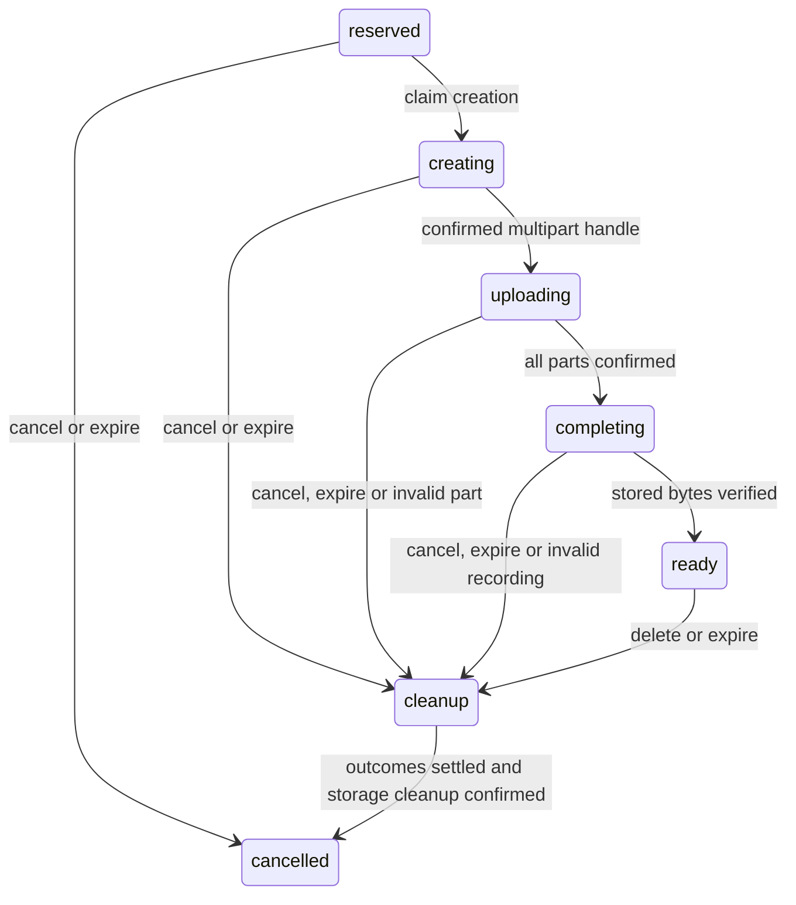

# Upload admission and cancellation ledger

`src/uploads.mjs` is a tested SQLite foundation for milestone 2. **It is not
connected to the Worker, an HTTP endpoint, R2, a signer or the native app.** The
existing test-media gateway still has no upload API. This change requires no
new secrets, services, billing changes or deployment.

Run the complete service suite with Node 24 or later:

```sh
cd services/media-gateway
npm run check
npm test
```

The upload tests use real SQLite, explicit test clocks and simulated provider
outcomes. They perform no network requests, upload no media and create no
provider accounts. They test ledger behavior, not real multipart interoperability.

## What this increment does

The ledger reserves bytes for one explicitly selected recording before allowing
storage work. Each reservation belongs to an authenticated owner, room and queue
occurrence. A supplied authority callback must recheck membership and ownership;
for admission and upload work it must also confirm that the occurrence is in
the authoritative current-plus-two lookahead window. It must return literal
`true`, synchronously. An asynchronous or absent callback fails closed.

These are deliberately smaller technical-spike limits than the eventual sharing
proposal: 16 MiB/file, 64 MiB/owner, 128 MiB/registry, three active uploads/owner,
two outstanding part leases/owner, 8 MiB parts, five-minute leases and absolute
24-hour retention from admission. There are at most 64 lifetime reservation
identities. Permanent cancellation tombstones count toward that limit. No
configuration or user setting enables larger limits in this change.

Ready objects and cancelled uploads awaiting physical cleanup still consume
quota. Observed storage overages increase the accounted bytes until deletion is
confirmed; a declared size cannot hide them. M1's manually registered objects
are **not** included in this isolated ledger. Before enabling uploads, one
authority must account for all reservations, retained objects and orphaned parts
together. These module limits are not a deployed storage or billing cap.

Admission accepts only opaque IDs, declared byte size, SHA-256, the initial
`mp3-44100-stereo` profile and `explicit_selection: true`. Local paths, filenames,
provider credentials and extra metadata are rejected. The hash is a resume
identity claim, not proof of uploaded contents and never an access credential.
There is no hash lookup or cross-owner deduplication. Equal hashes under two
owners create distinct reservations and storage keys.
Verified deduplication within one owner's authorization boundary and shared
reference tracking are still required before enabling the full sharing flow.

## Lifecycle and durability



Every mutation runs in a synchronous SQL transaction and waits for
`storage.sync()` before returning an acknowledgement or provider effect. The
same stable reservation ID can be retried only with its original identity.
Each mutation advances its ordered revision; cancellation also advances its
generation. A consumer must reject older revisions and generations while keeping
its pending UI intent visible. No application UI is wired to these snapshots yet.

`beginCreate` and `beginComplete` return an effect once; repeated calls return
`null`. A crash or lost response leaves the effect pending in persistent state.
The eventual executor must reconcile it rather than blindly create another
multipart session. S3 creation is not assumed idempotent. `null` settlement
means independently confirmed absence, **not** a timeout or missing response.
Ambiguous outcomes deliberately retain quota and block cleanup acknowledgement.

Cancellation can arrive before admission: `cancelBeforeAdmission` accepts the
original selected-file identity, checks authorization and records a tombstone
without reserving bytes. A late admission then returns cancelled state. After
provider work starts, cancellation denies further leases and completion while
keeping its reservation until the outstanding outcome is settled and storage is
cleaned. A late creation handle becomes abort work; a late completed object
becomes deletion work. Neither can restore `ready`.

Cleanup tasks are bounded batches of 16. Failures retry from one minute up to
15 minutes, retaining their state across ledger recreation. A future alarm/cron
executor must call `cleanupTasks`, settle ambiguous operations, abort multipart
work and confirm object deletion before `acknowledgeCleanup`. That method refuses
to release quota while creation or completion remains pending. Permanent
tombstones prevent reuse after deletion.

## Part progress and verification boundary

`leasePart` returns a part number, exact offset/size, generation, random lease ID
and deadline. It does not return a URL, provider handle or signing credential.
A repeated request preserves the live lease and deadline; its revision may
reflect newer work on another part. After expiry, a new lease ID makes older
receipts stale. Receipts are scoped to the current owner-controlled upload
generation. A completed part is counted once, and its ETag cannot be replaced.

Cancellation keeps unfinished, unexpired leases counted against the owner's
concurrency limit until confirmed cleanup or lease expiry. This bounds normal
scheduled work; it is not protection against replaying a bearer URL in many
parallel HTTP requests. A future signer and abuse policy must address that
separately. Before resuming, the native worker must rehash the explicitly chosen
file and compare both digest and size through `snapshot`.

Workers multipart part receipts are opaque completion tokens. The local R2
runtime returned a 171-character token, which the original 128-character object
ETag limit rejected. Part receipts now accept up to 1,024 visible ASCII
characters (excluding quotes) and preserve them byte for byte. They remain
server-only and are not proof of media contents. The stricter object ETag limit
is unchanged. Regression tests reject oversized/malformed receipts and confirm
that completion receives the original tokens after ledger recreation.
The receipt fix passed all 47 existing gateway/ledger tests on Windows,
including the new token-boundary regression.

`recordPart`, `settleCreate`, `settleComplete`, `cleanupFailed` and
`acknowledgeCleanup` are **trusted executor methods**, not participant commands.
Do not expose them as routes accepting a client's claim that upload or deletion
worked. The future executor must independently inspect storage and verify the
whole recording's digest, size and decoded profile. A multipart ETag, supplied
metadata or filename is not that proof. The ledger rejects mismatching verified
content into cleanup, including oversized parts and objects.

Public progress snapshots contain state, generation, revision, byte counts,
deadline and part progress. They omit file hashes, local paths, provider handles
and capabilities. Storage effect plans contain server-only keys/handles and
must never be sent to a room or logged. Future HTTP handlers must sanitize
unexpected database/provider errors; the module deliberately has no HTTP layer.

## Required before enabling uploads

- Finish M1's approved cloud and real desktop/Chromecast acceptance matrix.
- Implement authenticated owner/room membership and authoritative queue-window
  checks. Actor IDs must come from verified sessions, never request JSON.
- Integrate one quota authority across admission, multipart sessions, M1 assets,
  final playback assets and abandoned work. Validate schema/migration and
  durable-state recovery in the actual Worker runtime.
- Add direct-to-R2, narrowly scoped signing for one key, multipart upload, part,
  size and deadline. Validate enforced size bounds and retry/abort behavior
  against actual R2. No audio body goes through the gateway or Vercel.
- Add the native background file reader, hashing, bounded part transfers,
  cancellation and resume verification. Preserve optimistic UI and obtain any
  required visual approval before changing the interface.
  `src/shared_media.rs` and `prepare_shared_recording` now cover bounded offline
  preparation and identity checks for one selected file. They do not schedule
  transfers, connect to this ledger or provide an application upload interface.
- Implement independent stored-byte validation and the final immutable asset
  registration. The current ledger's `ready` status does not issue playback
  access or register an M1 asset.
- Add verified owner-scoped deduplication and reference-aware deletion. Knowledge
  of a hash must never create a reference to someone else's recording.
- Implement reconciliation for uncertain creation/completion and a lifecycle
  backstop for orphaned multipart sessions. A time limit alone is not proof
  that cleanup succeeded. Exercise real outages and restart recovery.

Validation on 2026-10-30: 19 focused upload-ledger tests passed on Windows,
including concurrent admissions, ownership isolation, stale receipts, duplicate
commands, cancellation before admission and during provider work, retention,
quota release, cleanup retries and durable acknowledgements. The combined
service suite passed 46 tests. No real multipart upload, native upload UI or
remote party was tested.

The default/all-feature Rust Clippy, all-target tests, doctests, warning-strict
rustdoc, formatting and policy checks also passed on Windows for this increment.
Local launcher tests still fail without Unix/Ruby prerequisites, and Jekyll
cannot run without Bundler. GitHub jobs are blocked before execution by the
account's billing/spending status, so no new Linux or macOS result is claimed.
